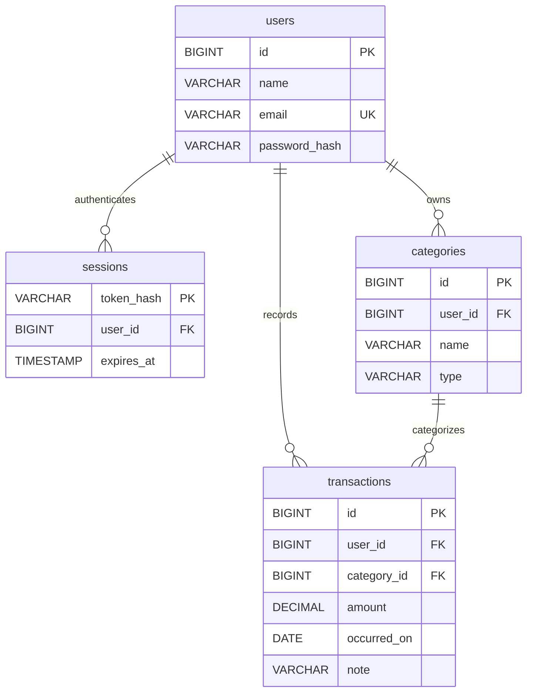

# Database design and presentation notes

| Table | Purpose | Main fields |
| --- | --- | --- |
| users | Registered users | id, name, unique email, BCrypt password hash |
| sessions | Expiring login sessions | SHA-256 token hash, user_id, expires_at |
| categories | User's income/expense categories | id, user_id, name, type |
| transactions | Ledger entries | id, user_id, category_id, amount, occurred_on, note |

## ER diagram

The composite category/user foreign key prevents assigning another user's category to a transaction.
Transaction type comes from the category, avoiding duplicated type values.
Amounts are positive; income/expense determines their effect on balance.

## SQL concepts to explain

- Primary keys identify each record; foreign keys maintain relationships.
- UNIQUE prevents duplicate emails and duplicate category names within a type/user.
- CHECK restricts type and positive amounts.
- Prepared statements prevent user input from becoming SQL syntax.
- JOIN combines transaction/category data.
- SUM, CASE and GROUP BY calculate totals and monthly breakdowns.
- A user/date index helps date filtering.
- Registration is transactional: user, default categories and session succeed together.

## Demo sequence

1. Register an account and show the default categories.
2. Add Salary income of ৳10,000 and Food expense of ৳250.50.
3. Show balance ৳9,749.50.
4. Edit Food to ৳300; show balance ৳9,700.
5. Filter by date/type/category and open the month's report.
6. Add a custom category; create a transaction under it.
7. Delete the Food transaction; show restored balance.
8. Log in as a second user and show an empty independent ledger.
9. Explain the API, tables and ordered Git commits.
